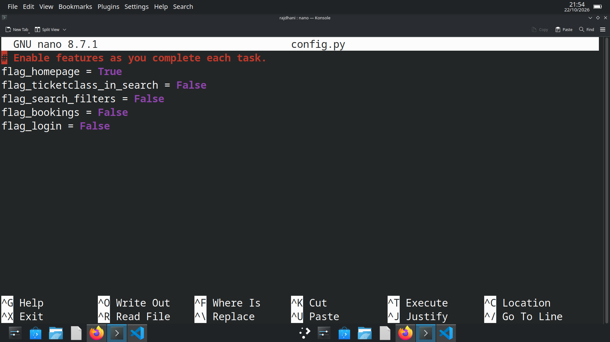
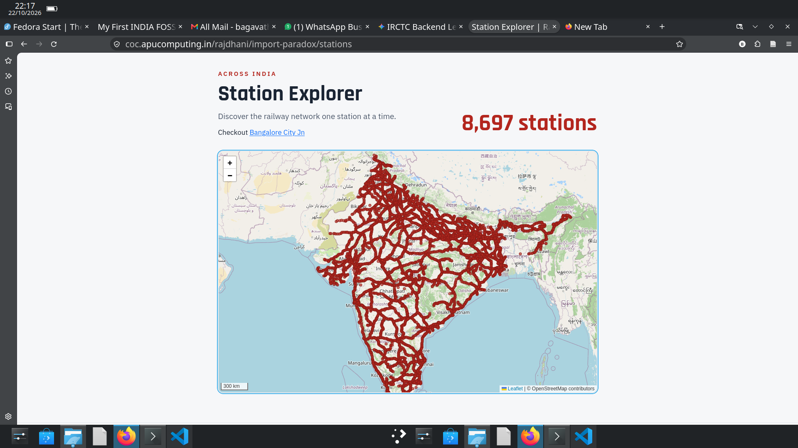
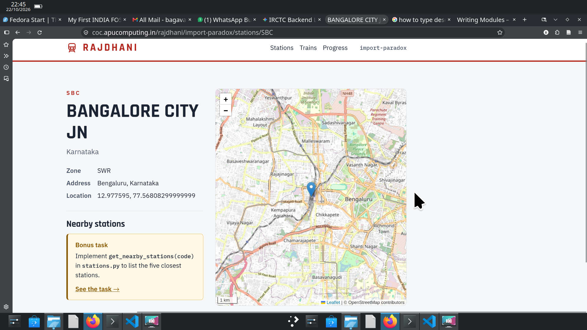
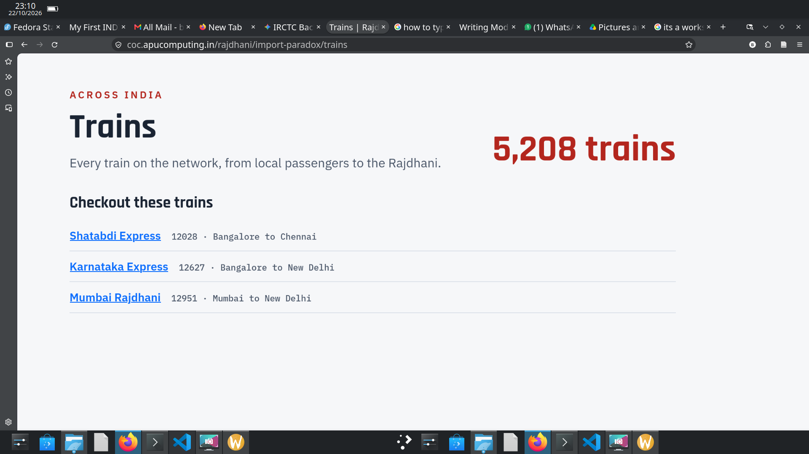
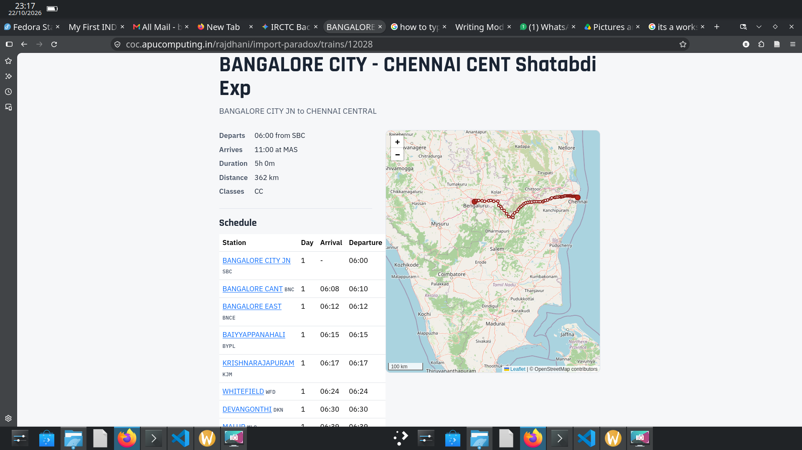
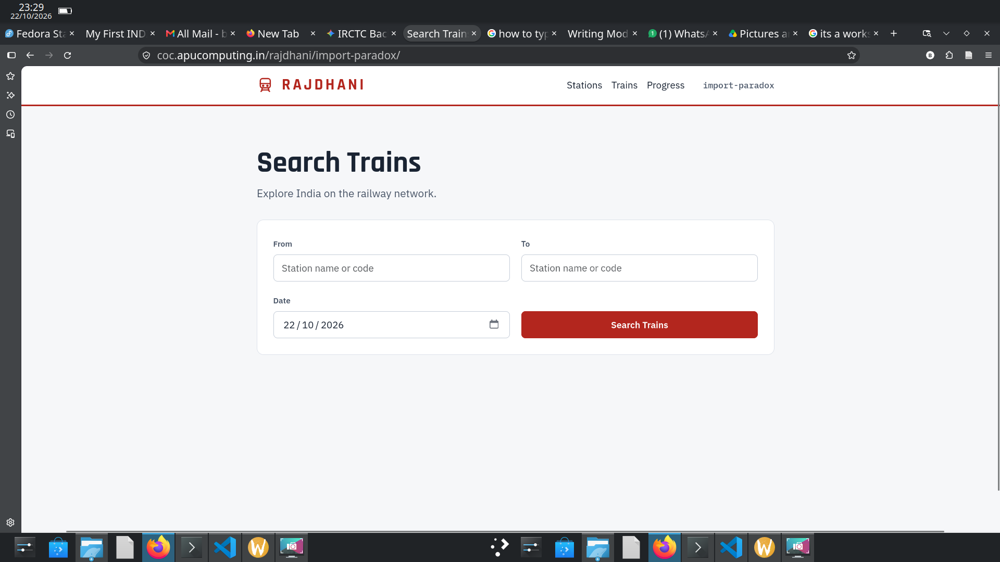
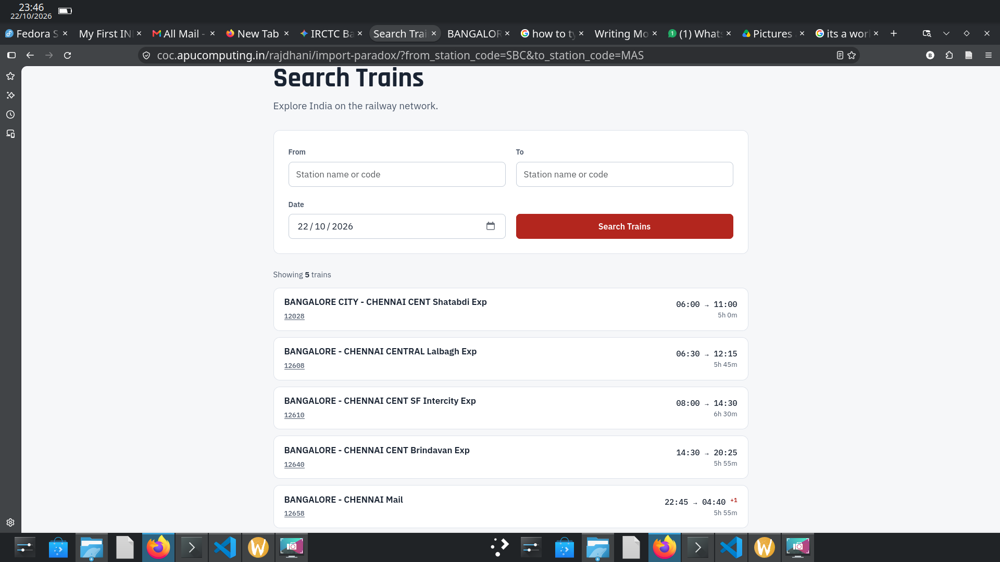

# Building My Own IRTC

## Introduction:
This blog was about how I worked on my project on building my own IRTC-A Train booking Website. I need to work on the backend of the software.I was given tasks by my instructor. Its blog was about how I approched that tasks. what are the miskates i did while doing that tasks.

## Task-1 - Enable the homepage





We have to enable the home page of our software.In config file we have to enable the train search homepage.

## Task-2 - Explore stations


In stations.py, we have to  write get_all_stations() funtion. Which load and return the list in data/stations.json to put every station on the Explorer map.

```python
""" Our task say that we have to return the data in list formate and but the data its in json. so it importing json module."""
import json 

def get_all_stations():
"""
 returns a list of all 8,697 stations with all required fields
"""
    stations = json.load(open("data/stations.json").read()) #open and read the json file
    return stations
```
## Task-3 - Show a station



In stations.py we have  write get_station(code). Which Use get_all_stations() and return the station dictionary whose code matches, or None when no station has that code. The Explorer links to a sample station page.

```python
def get_station(code):
    """
    This function return the station dictionary whose code matches, or None when no station has that code
    """
    stations = json.loads(open("data/stations.json").read())
    
    for station in stations:
        if station["code"] == code: # checking that the code given exist
        
            return station
```
### Mistake  I Did:
1. station["code"] # how we are accessing the code of the file which contain the data about the train stations.
1. Initially I was not definig the stations. It gave we some errors

## Task-4: Explore trains


In trains.py, write get_all_trains(). Load and return the list in data/trains.json. The Trains page shows how many trains there are.

```python
import json
def get_all_trains(): # Funtion returns all 5,208 trains
    
    trains = json.loads(open("data/trains.json").read())
    return trains
```

## Task-5: Show a train



In trains.py, write get_train(number). Use get_all_trains() and return the train dictionary whose number matches, or None when no train has that number.

```python
def get_train(number):
    """The function return the train dictionary whose number matches, or None when no train has that number."""

    trains = json.loads(open("data/trains.json").read())
    for train in trains:
        if train["number"] == number:
            return train
```

## Task-6 Show a train's schedule


In trains.py, write get_schedule(number). Load and return the list in data/schedules/<number>.json, for example data/schedules/12028.json. The train page lists the stops and draws the 
route on a map.

```python
def get_schedule(number):
    schedules = json.loads(open(f"data/schedules/{number}.json").read())
    for schedule in schedules:
        if schedule["train_number"] == number:
            return schedules
```

### My mistake 
I was keep searching how to use any number we enter as a argument. But later I found out f string that the key problem I faced here.

## Task-7: Search for stations

In stations.py, write search_stations(query). The function receives the text typed into the From or To field. Use get_all_stations() and return a list of matching station dictionaries. Match the query against code or name without regard to uppercase or lowercase letters, and return an empty list when nothing matches.



* This problem ask to get the argument regard of upper or lower case. so we convert the argument either to upper or lower using .upper() and .lower()
* even work in partial arguments we use. i use in keyword to do that 
* it also work in either code or name. so i used the logical argument

```python
def search_stations(query):
    """The function receives the text typed into the From or To field.
    Match the query against code or name without regard to uppercase or lowercase letters, and return an empty list when nothing matches."""
    
    stations = json.loads(open("data/stations.json").read())
    query = query.upper()
    x= [station for station in stations if query in station["code"] or query in station["name"]]
    return x
```

## Task-8-Search for trains:



In trains.py, write a function search_trains to find trains between two stations. Use the following signature for the function. Only the first two arguments are used now. The remaining arguments are used in later tasks. You only need to use the first two arguments for this task.

def search_trains(
    from_station_code,
    to_station_code,
    ticket_class=None,
    departure_date=None,
    departure_time=[ ],
    arrival_time=[ ]
):

Use get_all_trains() and return a list containing every train whose from_station_code exactly matches the first argument and whose to_station_code exactly matches the second argument.

Return the complete train dictionaries, or an empty list when no trains match. Only match the train's starting and ending stations; do not search its intermediate stops.

For example, a search from SBC to MAS returns trains 12028, 12608, 12610, 12640 and 12658.

```python
def search_trains(
    from_station_code,
    to_station_code,
    ticket_class=None,
    departure_date=None,
    departure_time=[],
    arrival_time=[]):"""
    funtion Return the complete train dictionaries, or an empty list when no trains match. Only match the train's starting and ending stations; do not search its intermediate stops."""
    x = [train for train in get_all_trains() if train["from_station_code"] == from_station_code and train["to_station_code"] == to_station_code]
    return x
```

## My Experiences of doing the Project:

I really enjoyed the tasks. Its was not that easy. I had very hard time puting the puzzle of code togeather. But  that made me to spend time on it ,figuring new stuff, new and different way to approach the problems. Only thing I was very sad about was I can't do team work. They showed no intreast in solving task.
I learned how to make our own funtions and do differnt task that we can also use funtion inside a function. I like the way the tasked are setup. But I dont like when am stuck even after the help from the instructor and other friends I can't really overcome the problems. 
