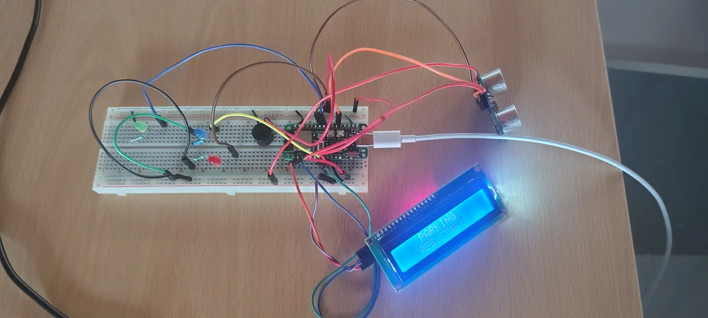

# Building an ESP32 Parking Assistant

## What I Built:
In this project, I build a parking assistant from an ESP32 board, an ultrasonic sensor, an LCD display and a buzzer. The sensor measures the distance to a vehicle as it moves towards it. When nothing is near, the display shows "THE Parking Assistance", and when something is, it shows the distance. As the vehicle comes close, the buzzer beeps. When it is very close, the display shows STOP and the buzzer sounds a continuous tone.

I broke the behaviour down into four clear stages:

1. Display "Parking Assistance" when an object is more than 100cm
1. Display distance of the object still  30  cm and above
1. Beep once the object is under 30 cm
1. Display shows "STOP" and coniteous beeping if the object is under 10 cm

## Challenges & How I Solved Them

* **Display not working:** Our first Task is to connect and test the display to working or not. Initially we thought it was our mistake connect the wire improperly. Then we tried changing the dispaly it worked.

* **Distance sensor reading issue**: After the LCD our next task is to connect the ultersonic sound sensor and dispaly the distance of the object. We did the connect but it kept showing "Nothing in Range". After Replacing Some pins and adjesting the wire it worked 

* **Writing code** : The code was already there we just need to do some adjustment to make that work in condition. So I tried to modify the code myself. I cant understand the code very well so. I did like this. if the object is very close under 10cm the red light glow and beep continous otherwise it only show the distace on the display.

## What I learned:

* The negative and postive part of the circuit should deal with carefully because lot of times its was misplaced.

* If somthing is not-working try to change the compounds after verifying the connect 

* Sometimes long connect not work because the polarsation will not make with long connection somtimes.

## What I Would Improve Next

If I build a second version of this, I would add a motor and a stick. so the stick will block the vechiel from certain close distance. once they pay money it will open.
like a toll gate we see it road.